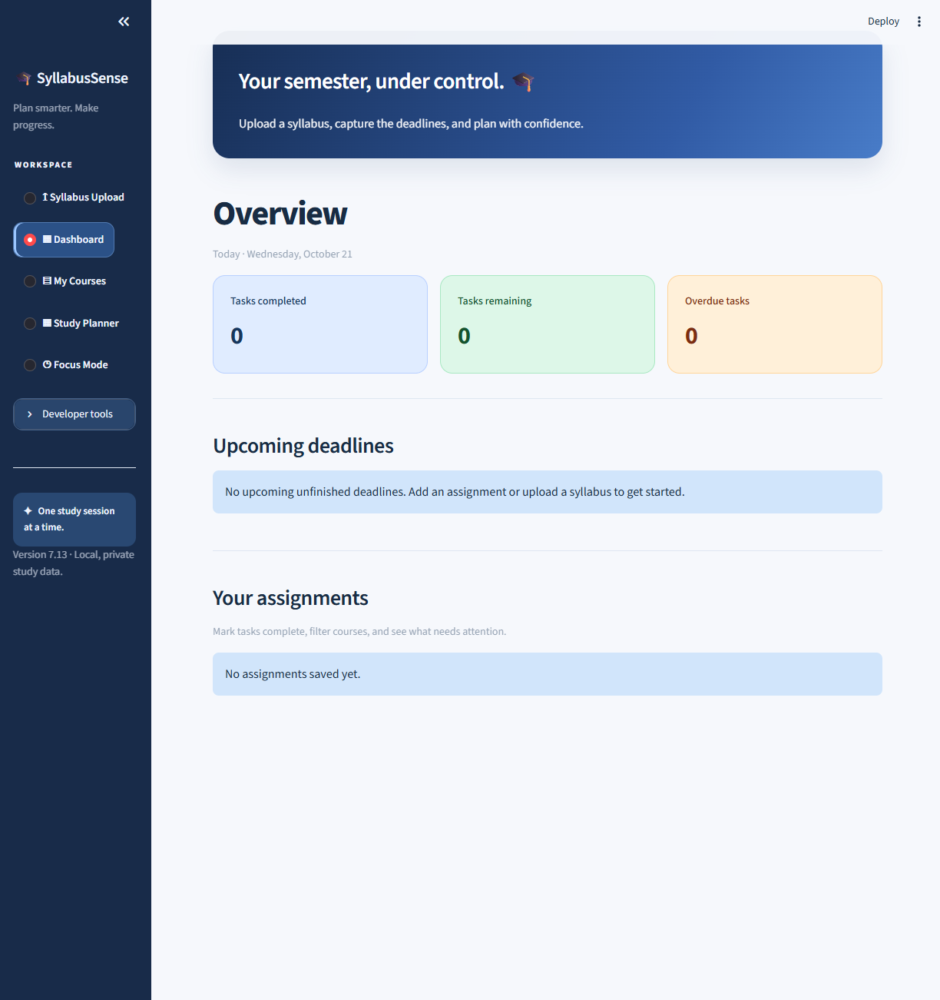
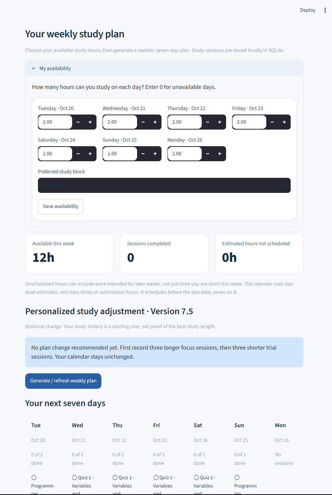
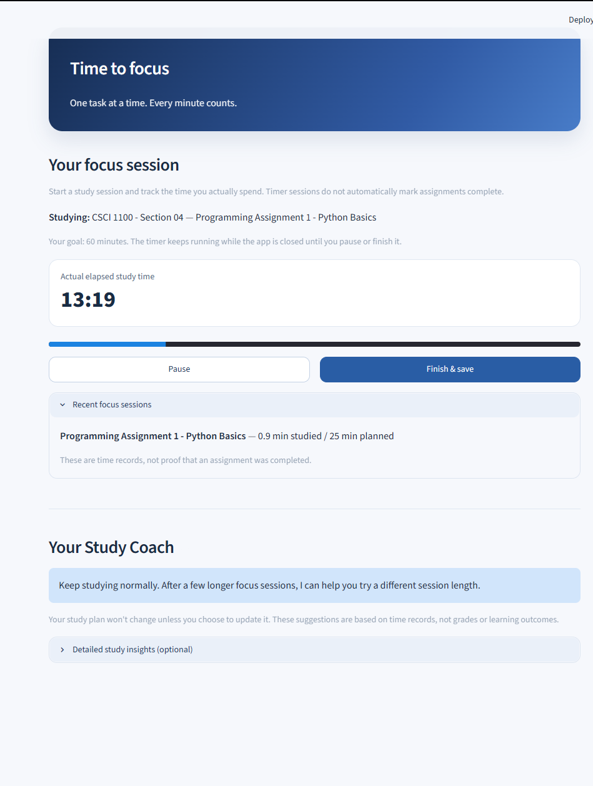

# SyllabusSense

**An AI-assisted academic planner that turns course syllabi into an actionable study plan.**

SyllabusSense is a personal software project built with Python and Streamlit. It helps students review assessment information extracted from PDF syllabi, keep track of assignments, plan study time, and log focused work sessions.

> **Status:** In active development (v7.13.1). This is a local prototype, not a hosted, multi-user service. AI-generated information must be reviewed by the student before use.

## Features

- **PDF syllabus review:** Upload a syllabus, extract readable text, and use Google Gemini to identify assessments and grading weights. Students review selections before saving.
- **Deadline transparency:** Separate confirmed dates from inferred dates and personal planning targets. Assignments can be saved with no announced due date and updated later.
- **Assignment dashboard:** Track upcoming work, completion status, and course-specific assignments.
- **Weekly study planner:** Generate study blocks using available time, estimated effort, and assignment dates.
- **Focus Mode:** Start, pause, resume, and save timed study sessions. Study blocks launched from the planner can be marked complete when their Focus session is finished.
- **Study Coach:** Review recorded focus sessions and explore study-session recommendations.
- **Course management:** Rename courses, manage assignments, and track newly imported syllabi.
- **Gemini reliability handling:** Retry temporary API failures and attempt a fallback model when configured models are available.

## Tech stack

| Component | Technology |
| --- | --- |
| Application and interface | Python, Streamlit, CSS |
| Local data storage | SQLite |
| AI-assisted extraction | Google Gemini API (`google-genai`) |
| PDF reading | `pypdf` |
| Data presentation | `pandas` |
| Version control | Git and GitHub |

## Getting started (local development)

**Prerequisites:** Python, Git (optional), and a Google Gemini API key for AI-powered features.

1. Clone the repository:

   ```bash
   git clone https://github.com/ATL-Jeremy/SyllabusSense.git
   cd SyllabusSense
   ```

2. Create and activate a virtual environment:

   **Windows PowerShell**
   ```powershell
   py -m venv .venv
   .\.venv\Scripts\Activate.ps1
   ```

   **macOS / Linux**
   ```bash
   python3 -m venv .venv
   source .venv/bin/activate
   ```

3. Install the Python dependencies:

   ```bash
   python -m pip install streamlit pandas pypdf google-genai
   ```

4. Create `.streamlit/secrets.toml` in the project directory and add your **own** key:

   ```toml
   GEMINI_API_KEY = "YOUR_OWN_GEMINI_API_KEY"
   ```

   **Never commit this file or share your API key.** It is excluded by `.gitignore`.

5. Start the application:

   ```bash
   python -m streamlit run app.py
   ```

6. Visit `http://localhost:8501` in your browser if it does not open automatically.

The app creates or updates its local SQLite database as needed. Uploaded documents and student data should be treated as private.

## How it works

1. Upload a PDF syllabus and request AI analysis.
2. Review identified assessments and verify any dates and grading information against the original syllabus or course portal.
3. Save assignments—even if the instructor has not yet provided a deadline.
4. Set study availability and generate a weekly plan.
5. Start a Focus Mode session from a study block, then review your progress.

**Important:** AI analysis can be incorrect or temporarily unavailable. Suggested planning dates are not official assignment deadlines. Follow your institution's academic-integrity and AI-use policies.

## Current limitations and planned improvements

- AI date suggestions can still return an error in some cases; this is under investigation.
- Empty courses and imported syllabus records may disappear when their final assignment is deleted; retention behavior needs fixing.
- The calendar is being redesigned into a more conventional day/week/month interface.
- Additional contrast and accessibility improvements are planned for file-upload controls and developer tooltips.
- The current version is designed for local individual use, not shared accounts or hosted deployment.

## Screenshots

The screenshots below are genuine captures of the local Streamlit prototype during development (from different test sessions). They are not AI-generated product mockups; screen details may differ slightly between versions.

### Dashboard



### Weekly Study Planner



### Focus Mode



## Project purpose

SyllabusSense began as a way to make course planning less manual: translate scattered syllabus requirements into manageable assignments and focused study sessions. The project is also an opportunity to build and test real software using APIs, databases, interface design, and iterative feedback.

**Developer:** [ATL-Jeremy](https://github.com/ATL-Jeremy)
